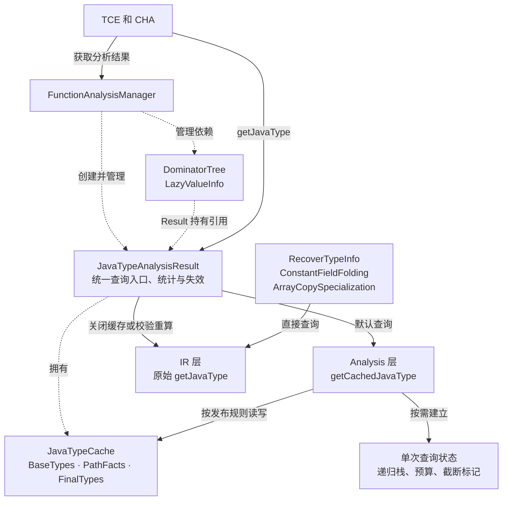
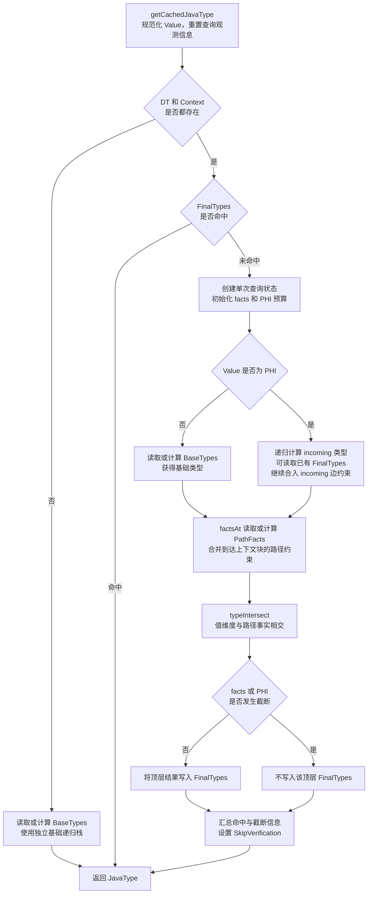
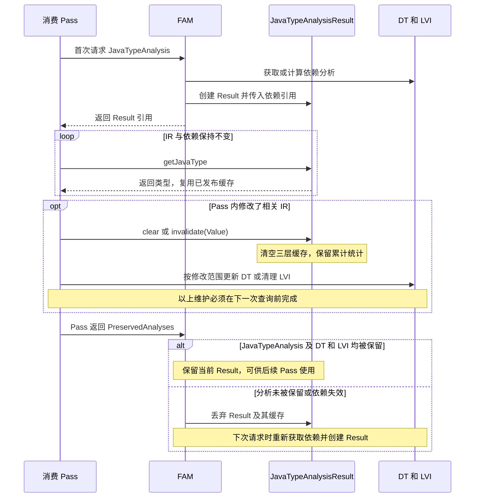

# Jeandle JavaTypeAnalysis 阶段工作报告

截至 2026 年 10 月 11 日，本阶段围绕 `getJavaType` 的重复计算问题，完成了 Function Analysis 接入、独立缓存查询引擎、三层缓存及两个优化 Pass 的调用迁移，并建立了可复现的验证流程。当前实现已具备受分析管理器管理的缓存生命周期、保守失效机制和运行统计，相关定向回归测试通过。

目前可以确认缓存查询链路已经实际生效。整体工作仍处于完善正确性验证和工程验收的阶段：真实 JVM 验证、完整专项回归以及性能收益评估尚未完成，因此暂不作“全部验收通过”或“已取得编译性能提升”的结论。

## 工作目标与当前进展

本工作的目标是在保持 Java 类型分析语义和使用约束的前提下，减少同一函数内重复的类型推导、控制流事实计算及相关 VM 回调。以 LLVM new PassManager 的 Function Analysis 作为缓存的管理边界，为优化 Pass 提供统一查询入口，并在 IR 或分析依赖发生变化后及时失效。

本阶段主要完成了以下工作：

1. 实现 `JavaTypeAnalysis` 和 `JavaTypeAnalysisResult`，通过 `FunctionAnalysisManager` 管理函数级分析结果。
2. 将缓存计算放入独立的 `CachedJavaType` 引擎，保留原始 `jeandle::getJavaType` 作为关闭缓存时的执行路径和结果对照。
3. 实现基础类型、路径事实和最终类型三层缓存，并区分可跨查询复用的结果与单次查询的递归状态。
4. 将 `TypeCheckElimination` 和 `CHADevirtualization` 接入新接口，处理 Pass 内修改 IR 后的缓存清理及依赖更新。
5. 增加缓存开关、对照校验、统计输出和 17 个缓存相关单元测试，使用既有 IR 测试及三模式对照验证接入效果。

与原始目标的对应关系如下。

| 目标 | 当前状态 | 仍需完成的工作 |
|---|---|---|
| 接入 Function Analysis 生命周期 | 已实现 | 补充跨 Pass 保留与依赖失效的直接测试 |
| 复用类型查询结果 | 已实现三层缓存，样例已观测到路径事实命中 | 在实际编译负载中量化复用范围和收益 |
| 迁移调用方 | TCE 和 CHA 已迁移 | 评估其他调用方的查询频率、修改行为及迁移价值 |
| 正确性验证 | 单元测试和相关 IR 回归通过 | 补强循环、查询顺序、失效及真实 JVM 场景 |
| 性能验证 | 已有统计和关闭缓存的对照入口 | 建立基线，测量查询、Pass 和端到端编译耗时 |
| 工程交付 | 已有提交、测试脚本和证据归档 | 整理未提交修改，将关键验收步骤纳入仓库自动化 |

## 版本基线与工作演进

本报告以当前源码和本次实际执行结果为准。早期研究文档用于说明目标和演进过程，其中的测试数量、缓存结构及验证规则不直接作为当前状态。

| 阶段 | 依据 | 主要内容 |
|---|---|---|
| 方案研究 | `Preliminary-Study`、`Final-Direction`、`Technical-Implementation` | 明确函数级管理边界、上下文敏感性、缓存失效与分阶段验证路线 |
| V1 实现 | 历史提交 `8019ed63c`，2026 年 9 月 1 日 | 建立 Function Analysis 包装、完整查询缓存、消费者接入和统计框架 |
| 当前架构 | 提交 `1e61901b4`，2026 年 9 月 29 日 | 拆分独立缓存引擎，引入三层共享缓存、LVI 适配及缓存单元测试 |
| 首次完整试验归档 | 2026 年 10 月 1 日试验报告 | 保存构建、回归、三模式对照及缓存运行证据 |
| 本次状态核验 | 2026 年 10 月 11 日 | 核对源码基线，重新执行验证流程并整理后续工作 |

`8019ed63c` 在本地仍可读取，但不是当前 HEAD 的祖先；这里将其作为历史阶段记录，不能据此表述为已沿当前分支连续合入。9 月 29 日提交涉及 18 个文件，新增 2546 行、删除 65 行；这些数字用于界定提交范围，不作为功能完成度或代码质量指标。该提交未修改原始 `IR/Jeandle/JavaType.h/.cpp`。

当前源码基线如下。

| 项目 | 状态 |
|---|---|
| 源码目录 | `/home/zjj/jeandle/jeandle-llvm` |
| 本地分支 | `main` |
| HEAD | `1e61901b4a01aff42f0566afab6aa0f9cb5de3cc` |
| 验证对象 | HEAD 加当前未提交修改 |
| 未提交修改 | `CachedJavaType.h`、`CachedJavaType.cpp`、`JavaTypeAnalysis.cpp` |
| 差异规模 | 3 个文件，新增 42 行、删除 21 行 |

未提交修改主要涉及基础类型查询递归栈的传参方式、注释和格式，另有一处 `getCachedJavaType` 入口非空断言删除。两处基础查询调用仍分别创建独立递归栈；此约束需要在后续整理中保留。上述差异必须作为待审查变更处理，不能仅凭测试通过视为已完成提交审查。

本次基线与 10 月 1 日归档的 HEAD、已跟踪文件差异及 10 个关键源码文件的 SHA256 均一致。本次工作更新了验证证据和阶段判断，没有修改分析实现。

## 当前架构

### 分层与调用关系

`JavaTypeAnalysis` 是函数级、按需计算的分析。`run()` 从 FAM 获取 DominatorTree 和 LazyValueInfo，并创建 Result；类型计算和缓存填充发生在消费者后续调用 `getJavaType()` 时。

图 1 展示组件之间的调用关系和数据归属。实线表示调用或数据访问，虚线表示对象管理及依赖引用。



共享缓存随 Result 保留；递归栈和预算随单次查询结束而释放。图中保留了未迁移调用方到原始引擎的路径，反映当前实际接入范围。

Result 持有 DT 和 LVI 的引用，依赖对象由 FAM 管理。`LVINullEdgeOracle` 使用 LVI 判断特定 CFG 边上的值是否可证明为 null，仅在有明确证明时跳过该边。将这一适配器放入 Analysis 层，使 IR 层继续通过 oracle 接口使用该能力。

原始接口目前仍被 `RecoverTypeInfo`、`ConstantFieldFolding` 和 `ArrayCopySpecialization` 直接调用。因此，当前成果的消费者范围是 TCE 和 CHA，尚不能表述为所有 JavaType 调用方均已迁移。

### 三层缓存

| 缓存 | 键 | 保存内容及作用 |
|---|---|---|
| `BaseTypes` | `Value *` | 来自属性、元数据及值传播的基础类型，复用不依赖查询位置的计算 |
| `PathFacts` | `(Value *, BasicBlock *)` | CFG 边条件推导并在汇合点合并的路径约束，供不同上下文查询复用 |
| `FinalTypes` | `(Value *, BasicBlock *)` | 顶层完整查询结果，复用值维度与路径事实相交后的类型 |

公开入口会规范化指针 cast、alias 和 freeze。无上下文查询使用基础类型路径；有上下文时先查最终类型缓存，未命中再计算值维度与路径事实。上下文键使用基本块，因为当前公开查询的上下文语义按块表达。

图 2 展示 `getCachedJavaType` 内部的查询和发布流程。关闭缓存及 verify 的对照重算由外层 Result 控制，不包含在本图中。



图中 `PathFacts` 的写入受路径事实截断标记控制，`BaseTypes` 的写入遵守基础递归的完成规则。`FinalTypes` 只在顶层发布；PHI 环标记会影响严格相等校验，但本身不等同于预算截断，发布规则见下一节。

`JavaType` 包含 `Klass`、`Exact`、`Interfaces` 和 `ExcludedKlasses`。它不表示 nullability；已知类型描述的是值作为非空 Java 对象时的类型约束。消费者仍需满足相应的非空使用契约，不能把“获得已知 JavaType”直接当作“值非空”的证明。

### 递归状态与结果发布

跨查询缓存与单次查询状态分开管理。PHI 递归栈、路径事实处理状态、facts/PHI 预算及截断标记均属于单次查询，不作为共享缓存条目保留。

当前实现的关键约束是：

- 完整计算出的 Unknown 也可缓存，避免反复计算相同未知结果。
- 路径事实预算耗尽或遇到无法按既定规则切断的 CFG 环后，受影响结果保留在本次查询内，不继续发布到共享路径事实缓存。
- facts 或 PHI 预算截断时，不发布该次顶层最终类型结果。
- PHI 递归只能读取已有的完整最终类型缓存，不将依赖外层递归栈的中间结果写入 `FinalTypes`。命中后仍需合入当前 incoming 边的约束。
- 基础类型递归使用独立栈，避免将外层上下文查询的 PHI 栈误认为自身递归环；其内部受环影响的非根结果不直接发布。

PHI 环跳过与预算截断需要区别处理：当前实现允许未发生预算截断的顶层 PHI 环查询结果缓存，但将相关查询标记为可能不满足冷热结果严格相等。已有测试展示了预热缓存后精度提高的情况，这也是后续验证需要重点覆盖的部分。

### 生命周期与失效

缓存归属于单个 Function 的 Result。Pass 未保留 `JavaTypeAnalysis`，或 DT/LVI 依赖失效时，FAM 丢弃该 Result。若修改发生在一个 Pass 内，FAM 的 Pass 边界失效尚未执行，调用方必须在下一次查询前主动清理缓存并维护依赖。

`clear()` 清空三层缓存并保留累计统计。`invalidate(Value &)` 当前也执行全量清空，只是为未来保留细粒度通知入口；尚未实现反向依赖图、自动监听 RAUW/删除或选择性条目失效。

TCE 先基于修改前的 IR 完成所有折叠决策，再批量替换和删除检查，最后清理缓存。CHA 在相关调用点改写及递归优化路径中更新 DT、清理 JavaType 缓存和 LVI；插入类型 assume 后，也会在继续查询前清理 JavaType 缓存。两者发生修改后均未显式保留 JavaTypeAnalysis。

图 3 区分 Pass 内主动清理与 Pass 边界的 FAM 失效。是否需要更新 DT、清理 LVI 取决于具体修改，但所有受影响的依赖都必须在下一次类型查询前恢复一致。



因此，当前实现已经具备跨查询复用能力，跨 Pass 复用还取决于 IR 是否变化以及分析是否被保留，不能把 FAM 接入本身视为跨 Pass 收益已经成立。

### 对照校验与统计

| 模式 | 参数 | 行为 |
|---|---|---|
| 默认 | 无额外参数 | Result 调用缓存引擎 |
| 关闭缓存 | `-jeandle-disable-java-type-cache` | 仍经过 FAM 和 Result，内部改用原始引擎 |
| 对照校验 | `-jeandle-verify-java-type-cache` | 查询缓存引擎，并用原始引擎重算；另做一次冷缓存诊断以判断是否应跳过严格相等比较 |

校验模式在每次经过 Result 的缓存查询上执行，包括 hit 和 miss；比较字段覆盖 `Klass`、`Exact`、`Interfaces` 和 `ExcludedKlasses`。遇到相关截断或 PHI 环标记时累计 `verification skips`。跳过仅表示本次未做严格相等判定，不属于校验通过的证据。

函数级 Printer 输出当前 Result 生命周期内的查询、缓存规模和耗时。模块级 `print<java-type-analysis-summary>` 输出进程累计计数，适合观察 Result 被失效销毁前发生的查询。模块级输出位置不改变统计的进程级范围，进行模式对照时应使用独立 `opt` 进程。

当前耗时统计覆盖查询入口，开启 verify 后还包含对照重算，因此不能使用 verify 模式的时间评估缓存性能。

## 本次验证情况

### 环境与执行记录

本次于 2026 年 10 月 11 日 14:01，在 WSL2 Linux x86_64 环境重新执行现有 `test-javatype-cache.sh`。构建目录为 `build/build-ninja-release`，配置为 Ninja、Release、X86、`LLVM_INCLUDE_TESTS=ON`，断言及 `LLVM_FORCE_ENABLE_STATS` 均关闭，构建和 lit 并发为 2。

脚本首先检查并构建 `opt`、`FileCheck`、`JavaTypeQueryTests`。本次 Ninja 返回 `no work to do`，表示目标已是最新，没有重新编译源文件。后续测试成功完成，脚本末尾再次核对 HEAD、工作区差异和关键文件摘要，确认执行期间基线未变化。

本次原始证据目录为：

```text
/home/zjj/jeandle/jeandle-llvm/build/build-ninja-release/javatype-experiments/run-20261011-140151-OqtZmJ
```

### 测试结果与覆盖范围

| 验证项 | 本次结果 | 说明 |
|---|---|---|
| 构建目标更新检查 | 通过 | 所需目标已是最新 |
| JavaType 缓存单元测试 | 17/17 通过 | 使用模拟 VM callbacks |
| 五个相关目录的 IR 回归 | 91/91 通过 | 无失败或跳过 |
| TCE 和 CHA 默认模式 | 29/29 条 RUN 通过 | 按原有 FileCheck 断言检查 |
| TCE 和 CHA 关闭缓存模式 | 29/29 条 RUN 通过 | 使用原始查询引擎 |
| TCE 和 CHA 校验模式 | 29/29 条 RUN 通过 | 未出现校验失败；不代表所有查询都未跳过比较 |
| 指定样例统计及 IR 比较 | 通过 | 三模式 FileCheck 通过，输出逐字节一致 |
| `git diff --check` | 未通过 | 当前差异有 9 处尾随空格，属于提交前整理项 |

单元测试覆盖基础类型共享、freeze 规范化、跨上下文路径事实复用、Unknown 缓存、上下文键区分、条件及属性变化后的显式清理、PHI incoming 命中后的边约束、预算截断、不可约环、PHI 中间结果不发布、冷热精度差异和关闭缓存路径。其中跨预算的原始引擎对照使用 0、1、128 三个预算，主要基于一个冷查询 fixture。

91 个 IR 回归测试的构成为：

| `llvm/test/Jeandle` 下的目录 | 用例数 |
|---|---:|
| `type-check-elimination` | 24 |
| `cha-devirtualization` | 4 |
| `java-type-metadata-recovery` | 26 |
| `constant-field-folding` | 36 |
| `arraycopy-specialization` | 1 |

这些 IR 测试在当前缓存提交之前已经存在，所选目录未被该提交修改。TCE 和 CHA 已直接使用新分析，其余目录主要检查相关类型逻辑与组合流程是否退化。三模式矩阵重跑的是其中 TCE 和 CHA 的 28 个文件、29 条 RUN，共 87 次命令执行，不能与 91 个用例相加后当作新增独立测试数量。

### 缓存实际生效的证据

在 `merge-direct-use.ll` 样例上，通过 TCE 后的进程累计统计观察到：

| 计数 | 默认 | 关闭缓存 | 校验 |
|---|---:|---:|---:|
| `queries` | 3 | 3 | 3 |
| `path facts hits` | 2 | 0 | 2 |
| `path facts misses` | 3 | 0 | 3 |
| `final type hits` | 0 | 0 | 0 |
| `final type misses` | 3 | 0 | 3 |
| `base insertions` | 1 | 0 | 1 |
| `clears` | 1 | 1 | 1 |
| `bypasses` | 0 | 3 | 0 |
| `verifications` | 0 | 0 | 3 |
| `verification skips` | 0 | 0 | 0 |

这组计数与源码调用链共同说明：默认查询实际进入了缓存引擎，并发生路径事实复用；关闭缓存时全部查询走原始引擎；校验模式的 3 次查询均完成比较。该样例没有最终类型缓存命中，`FinalTypes` 命中分支由单元测试另行覆盖。

样例预期是保留前面分支中的必要类型检查，并将汇合块的重复检查折叠为 `ret i1 true`。三模式均满足 FileCheck，输出 IR 逐字节相同。字节一致的结论仅适用于该样例；三模式矩阵验证的是所有原有断言，没有对全部输出逐字节比较。

### 验证结论的边界

当前结果支持继续进行实现审查和后续验收，但仍有以下明确缺口：

- 尚未运行全部 Jeandle LLVM 专项测试、全部上游 LLVM 测试及真实 JDK/JVM 的 jtreg 验证。
- 尚未运行开启断言的构建及 ASan/UBSan 检查。当前 Release 测试通过不能替代这些检查。
- 预算与 PHI 环场景可能跳过严格相等校验；需要通过明确期望类型和语义有效性的测试补充证据，不能仅以没有 mismatch 作为正确性结论。
- 当前单元测试使用简化类型层次，接口关系、排除类型组合、热缓存查询顺序和更多 IR 失效路径仍需扩展。
- 尚未测量真实负载中的 callback 减少量、缓存内存成本、Pass 耗时和端到端编译性能。测试执行时间和单一样例的命中次数不构成性能收益证据。

本次检查还确认，JDK release 配置中的 `JT_HOME` 为空，当前环境也未设置 `JT_HOME`。运行现有 JDK 测试脚本前，需要准备并指定含 `lib/jtreg.jar` 的 jtreg 目录；当前尚未验证是否存在其他可用安装位置。

## 下一步工作安排

后续优先完成当前实现的正确性和交付验收，再根据实测数据决定是否扩大缓存范围。建议按以下顺序推进。

| 优先级 | 工作项 | 完成标准 |
|---|---|---|
| P0 | 整理并审查当前未提交修改 | 补全或删除占位注释，清理尾随空格，确认入口断言删除的理由及接口前置条件；`git diff --check` 通过，并对最终提交候选版本重新归档验证结果 |
| P0 | 补强 PHI 环和预算场景 | 增加不同查询顺序、低预算冷热缓存、复杂接口与排除类型组合；对允许精度不同的结果验证实际类型约束成立，并记录 skips 的原因与范围 |
| P1 | 补齐生命周期测试并纳入自动化 | 直接覆盖 FAM 保留/失效、DT/LVI 依赖变化、RAUW/删除及 CFG 修改后的重查；将关键模式和统计断言放入仓库内测试或 CI |
| P1 | 扩大回归配置与运行环境 | 完成全部 Jeandle LLVM 专项回归，记录 Unsupported 原因；完成断言构建和适用的 sanitizer 检查；更新 LLVM/JDK 产物后完成 jtreg 定向及专项测试 |
| P1 | 建立性能基线 | 同一源码、配置和负载下，多轮比较默认与关闭缓存模式，关闭 verify；报告查询/Pass/编译耗时、回调次数、命中及清理次数、内存规模和波动范围 |
| P2 | 根据瓶颈优化与扩展 | 在数据支持后，再考虑其他消费者迁移、JVM 类型关系缓存或细粒度失效；每项改动配套独立测试和收益比较 |

循环场景的验收需要同时检查“允许冷热精度不同”和“每个结果仍然成立”。仅证明热结果比冷结果更窄不足以证明正确，测试应给出能够独立判断的类型期望，避免把缓存引擎与自身的一致性当作唯一依据。

失效方面，当前全量清理策略容易审查，但可能限制复用。应先测量清理频率和重算成本，再决定是否引入反向依赖关系；在缺少数据时直接放宽清理规则，会增加陈旧结果风险。

独立缓存引擎也带来维护成本：原始类型推导逻辑后续更新时，需要同步审查缓存版本，并保留原始引擎对照测试。当前保留独立执行路径有助于发现差异，但不意味着两者所有底层类型运算和 VM 回调完全独立。

## 当前验证操作

### 一键复现

以下命令复现本报告已执行的范围，包括构建检查、17 个单元测试、91 个 IR 回归、三模式矩阵以及样例统计和 IR 比较。

```bash
cd /home/zjj/jeandle/jeandle-llvm
JOBS=2 /home/zjj/jeandle/build_shells/test-javatype-cache.sh
```

成功时最后输出 `PASS` 及本次证据目录；只有全部步骤和断言成功后才生成 `SUCCESS.txt`。任一步骤失败，脚本以非零状态退出。默认每次创建新的结果目录，不覆盖已有证据。

需要使用其他已配置的构建目录时，可以指定：

```bash
LLVM_SRC=/home/zjj/jeandle/jeandle-llvm \
LLVM_BUILD=/home/zjj/jeandle/jeandle-llvm/build/build-ninja-release \
JOBS=2 \
/home/zjj/jeandle/build_shells/test-javatype-cache.sh
```

脚本中的三模式适配器仅支持当前测试所用的单行 `opt ... | FileCheck ...` RUN 形式；新增续行或其他 lit 替换需要扩展适配器或迁入标准测试配置。样例计数也有固定断言，计数变化时应先审查变化原因。

### 分步定位问题

在新的 Bash 子 shell 中执行下列代码；`set -euo pipefail` 确保构建失败后不会继续用旧二进制运行测试。

```bash
(
  set -euo pipefail
  cd /home/zjj/jeandle/jeandle-llvm

  git status --short
  git rev-parse HEAD
  cmake --build build/build-ninja-release \
    --target opt FileCheck JavaTypeQueryTests --parallel 2

  build/build-ninja-release/unittests/IR/JavaTypeQueryTests \
    --gtest_filter='JavaTypeQueryTest.*'

  build/build-ninja-release/bin/llvm-lit -sv -j 2 \
    llvm/test/Jeandle/type-check-elimination \
    llvm/test/Jeandle/cha-devirtualization \
    llvm/test/Jeandle/java-type-metadata-recovery \
    llvm/test/Jeandle/constant-field-folding \
    llvm/test/Jeandle/arraycopy-specialization
)
```

需要集中检查 PHI、预算和失效时，使用以下过滤器：

```bash
build/build-ninja-release/unittests/IR/JavaTypeQueryTests \
  --gtest_filter='JavaTypeQueryTest.*Phi*:JavaTypeQueryTest.*Budget*:JavaTypeQueryTest.ResultInvalidationAfterConditionAndAttributeChange'
```

### 查看实际缓存命中并比较输出

完成上述构建检查后，执行以下代码。它为三个模式分别启动 `opt`，保存统计、检查输出并比较样例 IR。

```bash
(
  set -euo pipefail
  cd /home/zjj/jeandle/jeandle-llvm
  sample_dir=$(mktemp -d /tmp/javatype-sample-XXXXXXXX)
  fixture=llvm/test/Jeandle/type-check-elimination/merge-direct-use.ll
  callback=llvm/test/Jeandle/type-check-elimination/Inputs/merge-direct-use.cblog

  for mode in default original verify; do
    flags=()
    case "$mode" in
      original) flags=(-jeandle-disable-java-type-cache) ;;
      verify) flags=(-jeandle-verify-java-type-cache) ;;
    esac
    build/build-ninja-release/bin/opt -S \
      -passes='function(type-check-elimination),print<java-type-analysis-summary>' \
      "${flags[@]}" "-jeandle-vm-callback-log=$callback" "$fixture" \
      > "$sample_dir/$mode.ll" 2> "$sample_dir/$mode.stats"
    build/build-ninja-release/bin/FileCheck "$fixture" \
      < "$sample_dir/$mode.ll"
  done

  diff -u "$sample_dir/default.ll" "$sample_dir/original.ll"
  diff -u "$sample_dir/default.ll" "$sample_dir/verify.ll"
  rg 'queries:|path facts hits:|bypasses:|verifications:|verification skips:' \
    "$sample_dir"/*.stats
  printf '样例输出目录：%s\n' "$sample_dir"
)
```

当前样例预期：默认 `path facts hits: 2`，关闭缓存 `bypasses: 3`，校验模式 `verifications: 3` 且 `verification skips: 0`；两个 diff 无差异。上述命令只检查指定样例，完整矩阵使用一键脚本。

### 后续扩大验收范围

以下操作列为下一阶段验证，本次尚未执行。

全部 Jeandle LLVM 专项测试：

```bash
JOBS=2 /home/zjj/jeandle/build_shells/test.sh all llvm
```

真实 JVM 验证前，先通过现有构建脚本更新 LLVM 安装和 JDK，避免测试仍链接旧版本。该步骤会编译、安装 LLVM 并构建 JDK，执行范围大于当前 LLVM 定向验证。

```bash
JOBS=2 /home/zjj/jeandle/build_shells/build.sh release
```

准备好 jtreg 后，将下列路径替换为实际目录，再运行 JDK 定向和全部 Jeandle 专项测试：

```bash
JT_HOME=/实际的/jtreg目录 JOBS=2 \
  /home/zjj/jeandle/build_shells/test.sh java-type jdk

JT_HOME=/实际的/jtreg目录 JOBS=2 \
  /home/zjj/jeandle/build_shells/test.sh all jdk
```

当前 JDK 定向范围包含 `typeMetadataRecovery` 下 3 个 Java 文件和 `typeCheckElimination` 下 1 个 Java 文件；文件数不等于 jtreg 实际执行次数。现有 `test.sh` 固定使用 release 配置，运行 `build.sh debug` 不会自动切换其测试目标。这里的 `all` 仅指 Jeandle 专项，不是整个上游 LLVM 或 JDK 测试集。

## 参考资料与证据

设计和历史资料：

- [项目目标](Project.md)
- [初步研究](JavaTypeAnalysis-Preliminary-Study.md)
- [最终方向](JavaTypeAnalysis-Final-Direction.md)
- [技术实现方案](JavaTypeAnalysis-Technical-Implementation.md)
- [V1 实现摘要](JavaTypeAnalysis-V1-Summary.md)与[V1 检验方案](JavaTypeAnalysis-V1-Verification.md)，用于历史参考
- [2026 年 10 月 1 日缓存试验报告](JavaTypeAnalysis-Cache-Experiment-2026-10-01.md)

当前实现和验证入口：

- [Analysis 接口](../jeandle-llvm/llvm/include/llvm/Analysis/Jeandle/JavaTypeAnalysis.h)与[Analysis 实现](../jeandle-llvm/llvm/lib/Analysis/Jeandle/JavaTypeAnalysis.cpp)
- [缓存结构](../jeandle-llvm/llvm/include/llvm/Analysis/Jeandle/CachedJavaType.h)与[缓存引擎](../jeandle-llvm/llvm/lib/Analysis/Jeandle/CachedJavaType.cpp)
- [原始类型查询契约](../jeandle-llvm/llvm/include/llvm/IR/Jeandle/JavaType.h)
- [缓存单元测试](../jeandle-llvm/llvm/unittests/IR/JavaTypeQueryTest.cpp)
- [验证脚本](../build_shells/test-javatype-cache.sh)
- [本次源码清单](../jeandle-llvm/build/build-ninja-release/javatype-experiments/run-20261011-140151-OqtZmJ/manifest.json)、[工作区补丁](../jeandle-llvm/build/build-ninja-release/javatype-experiments/run-20261011-140151-OqtZmJ/worktree.patch)、[单元测试结果](../jeandle-llvm/build/build-ninja-release/javatype-experiments/run-20261011-140151-OqtZmJ/unit.log)、[IR 回归结果](../jeandle-llvm/build/build-ninja-release/javatype-experiments/run-20261011-140151-OqtZmJ/lit.log)、[三模式结果](../jeandle-llvm/build/build-ninja-release/javatype-experiments/run-20261011-140151-OqtZmJ/matrix.json)和[样例统计](../jeandle-llvm/build/build-ninja-release/javatype-experiments/run-20261011-140151-OqtZmJ/stats.json)

旧 V1 文档中“仅在 hit 时校验”、单层缓存结构、旧统计字段及旧测试数量已不适用于当前实现。当前架构和验证结论以本报告及对应源码、原始日志为准。
