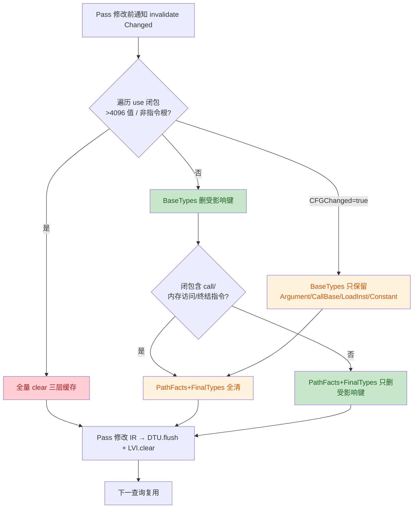
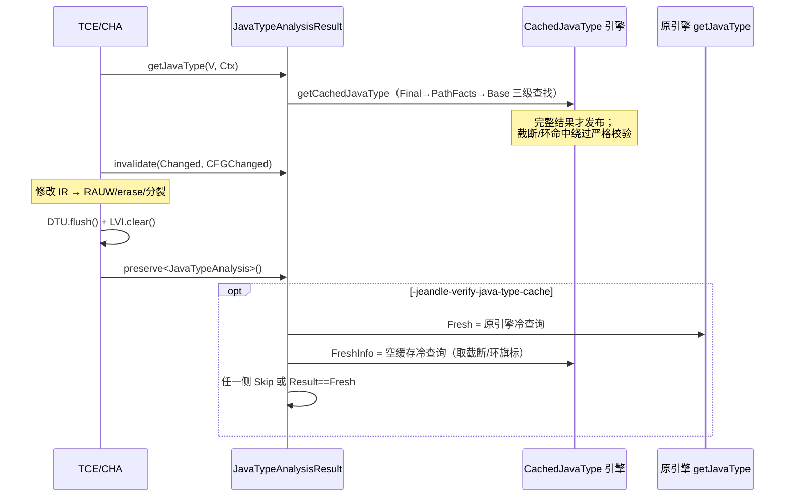

# 代码审查报告：JavaType 缓存选择性失效

- **对象**：[`main...Atm2086:jeandle-llvm:feat/javatype-selective-invalidation`](https://github.com/jeandle/jeandle-llvm/compare/main...Atm2086:jeandle-llvm:feat/javatype-selective-invalidation)
- **范围**：6 个提交（`1e61901b4` 缓存引擎隔离 → `ab6902023` 基线快照 → `34cdbcf19` 选择性失效主体 → `14058bf20` 内存访问依赖补强 → `7a297b93b`/`7d50983c0` 文档），24 个文件
- **焦点**：缓存正确性、选择性失效、所有权/生命周期、编译、线程安全、性能、测试
- **方法**：全量 diff + 分支顶端源码逐行精读（本地镜像 `/tmp/jeandle-review/new/llvm/`，行号 = 分支顶端新版本）；与原引擎 `lib/IR/Jeandle/JavaType.cpp` 逐函数机械比对；TCE/CHA 消费者端到端时序审计；双独立子代理对抗性交叉验证（10 项候选发现，2/2 确认 7 项、证伪 2 项、修正 1 项转述）；关键 API 假设（`ALWAYS_ENABLED_STATISTIC`、`LazyValueInfo::clear()`、`LazyValueAnalysis`、`reportFatalInternalError`、`PARTIAL_SOURCES_INTENDED`、`Statistic` 原子性）已对照远端 LLVM 树核实
- **日期**：2026-10-21 · **结论**：可合并质量较高，无现行正确性缺陷；1 项 P1 防御性设计问题 + 3 项 P2 建议在合并前解决

---

## 1. 变更概述与意图

将 `JavaTypeAnalysis` 三层缓存（`BaseTypes`：键 `Value*`；`PathFacts`/`FinalTypes`：键 `(Value*, BasicBlock*)`）从"每次修改通知全量清空"改为：

1. **修改前通知** → 沿 SSA `Value::users()` 传播求受影响闭包（上限 4096 值 / 16384 use，超限回退全清）；
2. **分层失效**：BaseTypes 删受影响键；闭包含 call/内存访问/终结指令则 `DropContext` 全清两个上下文缓存；`CFGChanged=true` 时 BaseTypes 仅保留 `Argument/CallBase/LoadInst/Constant` 四类"叶子"键；
3. 消费者负责"通知 → 变更 → DTU.flush + LVI.clear → preserve"的顺序，TCE/CHA 已接入。

---

## 2. 已验证正确的部分（双验证者 + 主审一致）

| 结论 | 证据 |
| --- | --- |
| **消费者失效纪律完备**：TCE 决策/执行分离，批量 `invalidate(ChangedChecks)` 先于 RAUW+erase（`TypeCheckElimination.cpp:168-191`）；CHA 全部路径（`_invokeBasic`、linkTo* 提交/回滚、空检查分裂、虚调用 guard、`optimizeCallSite(*NewCB)` 递归重入）均为"通知→变更→DTU.flush/LVI.clear→查询"，未发现无覆盖变更或可见陈旧 DT/LVI 窗口 | 三方独立审计均无反例；static linkTo* 路径 `hasReceiver=false` 时 `InvokeInst` 仍触发 `isa<CallBase>` → `DropContext`，上下文缓存照样全清，无漏 |
| **块分裂安全**：`insertCheckInstanceOf`/`insertNullCheck`（`JeandleTransformUtils.cpp:214-274`）只 `SplitBlock` + 新建块、搬运指令；被 erase 的临时终结符系 `SplitBlock` 刚创建、从不可能成为缓存键；`CFGChanged=true` 的上下文全清恰好覆盖 `(V, BB)` 键随块分裂变陈旧的风险；`CFGChanged` 保留名单对块搬运免疫（四类叶子基型只读属性/元数据/对象身份） | 逐行核对工具函数 |
| **引擎复制忠实**：`CachedJavaType.cpp` 与 `lib/IR/Jeandle/JavaType.cpp` 逐函数机械 diff，共享算法函数（`getBaseJavaTypeCase`、`traceToCheckInstanceof`、`edgeGuard`、`mergePathFacts` 等）逐字节一致，差异仅为缓存钩子（`factsAt` PathFacts 查找/发布、`phiValueType` FinalTypes 只读命中、截断/环旗标） | 脚本化逐函数比对，~1290 行相同 |
| **差分验证方案自洽**：`JavaTypeAnalysis.cpp:206-223` 用**空缓存**冷求值（`DiagnosticCache`）取旗标，`Info.SkipVerification \|\| FreshInfo.SkipVerification` 的析取覆盖所有可构造的热/冷精度差——含 FinalTypes 命中导致的 PHI 环精度提升（单测 `CompletePhiCacheCanImproveCyclePrecision` 固化了 warm=22/cold=1 且靠 FreshInfo 侧旗标跳过的行为） | 逐一构造发散路径均被 FreshInfo（空缓存，冷侧旗标 ⊇ 热侧旗标）拦截 |
| **线程安全疑虑排除**：本 fork `Statistic::Value` 为 `std::atomic<uint64_t>`（`ADT/Statistic.h:56`，远端核实），cl 注册表静态初始化后只读；`JavaTypeCache` 随 Function 级 Result 隔离 | SSH 核实 |
| **FAM 失效回调正确**：`JavaTypeAnalysisResult::invalidate`（`JavaTypeAnalysis.cpp:301-310`）在未显式保留或 DT/LVI 失效时整体丢弃 Result，非消费者 pass 无法留下陈旧缓存 | — |
| **测试与基准方法学扎实**：26 项单测（9 项新增：传递用户失效/RAUW/CFG 删边与 PHI 重算/guard 非键依赖/强制全清开关/不支持根回退/遍历超限回退/内存访问非键依赖/预算与环发布门控）；lit `selective-invalidation.ll` 三模式计数回归；基准脚本含五模式输出 IR 字节一致校验、`verification skips == 0` 门禁、预热+随机轮转+配对 bootstrap、源码/opt 哈希防漂移、`worktree.patch` 存档 | `benchmark-java-type-invalidation.py` 全文精读 |

---

## 3. 问题清单（按优先级）

### P1-1 三层缓存全裸 `Value*`/`BasicBlock*` 键，无 ValueHandle 安全网（防御性设计缺口）〔2/2 验证者确认，major〕

- **位置**：`llvm/include/llvm/Analysis/Jeandle/CachedJavaType.h:43-51`（契约注释与三张 `DenseMap` 成员）、`llvm/lib/Analysis/Jeandle/CachedJavaType.cpp:41-123`（`invalidate` 依赖修改前 `Value::users()` 遍历）、原引擎警告 `llvm/lib/IR/Jeandle/JavaType.cpp:1259-1265`
- **问题**：正确性 100% 押在"消费者在每次 RAUW/删除前通知"的注释契约上，无任何程序化防护。原引擎注释明确拒绝 pass 级 memo 的原因逐字应验于此方案："*A pass-scoped memo would additionally need invalidation discipline … dangling Value* keys could alias freshly allocated values and return stale facts*"。LLVM `User` 内存可回收（LifetimeManager），漏通知 → 悬垂键可被新指令别名 → **静默返回陈旧 JavaType → 潜在错编译**，且 `-jeandle-verify-java-type-cache` 默认关闭。当前 TCE/CHA 均合规，故非现行 bug；但同分支 PEA/DeoptPool 组件大量使用 `WeakTrackingVH`，说明现成方案就在代码库里。
- **附加风险面**：验证者指出 `ConstantFieldFolding.cpp` 有 32 处 mid-pass erase 且是原引擎注释点名的"最薄弱未来接入点"——任何把它迁移到共享缓存 API 的后续工作都先撞上本缺口。
- **附带契约瑕疵**：`insertCheckInstanceOf`/`insertNullCheck` erase `SplitBlock` 临时终结符时不通知，当下安全（临时终结符从不是键），但与头文件"*Every erased value must be notified while still live*"的字面要求相悖——契约宜写明"查询之后新建又随即删除的值"豁免。
- **建议**：① 三张 map 改 `WeakTrackingVH` 键（或 +Asserts 构建下 `AssertingVH`/失效断言兜底），使契约违反变成响亮崩溃而非静默错型；② 收紧契约措辞；③ 在 `ConstantFieldFolding` 接入前完成 ①。

### P2-2 `getFactsJoinBudget()` 全局 cl 注册表查找，release 构建下为 UB 地雷〔2/2 确认〕

- **位置**：`llvm/lib/Analysis/Jeandle/CachedJavaType.cpp:1106-1110`（实现）、`:1145-1151`（构造函数 `FactsBudget`/`PhiBudget` 各调用一次 = 每上下文查询 2 次全局 StringMap 查找）；选项注册于 `lib/IR/Jeandle/JavaType.cpp:1249-1251`
- **问题**：`cl::getRegisteredOptions().lookup("jeandle-max-facts-join-blocks")` 仅 `assert` 判空后 `static_cast` 解引用。项目自身 Release 配置（`LLVM_ENABLE_ASSERTIONS=OFF`）下，将来改名/拆库/链接裁剪 → 空指针解引用 UB。同一模式还被复制进测试工具类 `ScopedQueryOption`（`JavaTypeQueryTest.cpp:30-41`，同样无判空）。
- **建议**：在 `IR/Jeandle/JavaType.cpp` 暴露 `unsigned jeandle::getMaxFactsJoinBlocks()` 访问器（或按引用捕获 `cl::opt` 缓存于引擎内），消除注册表查找与类型双关；测试工具类同步加防御。

### P2-3 `IsRoot` 豁免向共享缓存发布 PHI 环污染条目 + 基维 `CycleHit` 被丢弃〔2/2 确认代码事实；严重度存在验证分歧，主审裁定为"契约/注释矛盾"而非现行 bug〕

- **位置**：注释 `CachedJavaType.cpp:244-251`（"*Entries are written only for computations that never hit a PHI cycle … must not be reused*"）vs 代码 `:429-439`（`if (IsRoot || !CycleHit) Memo[V] = R;`，`:436`）；共享发布通道 `:1434`（`Memo = Cache.BaseTypes`）与 `:1419`（`valueDimension` 以 `IsRoot=true` 调用）；基维旗标丢弃 `:444-451`（局部 `bool CycleHit`）、`SkipVerification` 组装 `:1461`（仅 `Q.FactsTruncated || Q.PhiTruncated || Q.PhiCycleHit`）；base-only 直接暴露面 `:1436-1443`
- **问题（两个层面）**：
  1. **注释矛盾**：原引擎同样的根豁免只写进单查询 memo（无害）；缓存引擎把 `Cache.BaseTypes` 作为该 memo 传入后，环命中的查询根被发布进**跨查询**共享缓存，直接违反同文件 9 行之上的注释不变式；
  2. **旗标语义缺口**：`SkipVerification` 文档语义为"*after truncation or a PHI cycle*"，但基维 PHI 环的 `CycleHit` 在 `getBaseJavaType` 即被丢弃，永远到不了 `Info.SkipVerification`；base-only 路径完全不设旗标。
- **分歧裁定**：验证者 A 认为可构造 `-jeandle-verify-java-type-cache` 合法误报 fatal；验证者 B 系统构造反例后证明基维环剪 LUB 具**入口无关性**（memo 查找先于栈检查；环剪贡献对称传播；含 select/bitcast 穿环与毒臂的场景热冷收敛相等）。主审独立推导与 B 一致：BaseTypes 命中值恒等于以同键为根的全新冷求值 → 当前**不可构造**误报。故定级为注释矛盾 + 旗标契约名不副实（一旦环处理策略调整即成活体风险）。
- **建议**：① 环命中根不发布进共享 memo（仅本次查询可见），或把基维 `CycleHit` 传出并入 `SkipVerification`；② 补一个"环状 PHI base-only 热/冷差分"定向单测，把入口无关性不变式固化成回归。

### P2-4 ~1290 行引擎整体复制，双引擎人工同步负担〔2/2 确认〕

- **位置**：`CachedJavaType.cpp:125-130`（自述分叉注释"*Query algorithm fixes must be reviewed for both engines*"）；重复区间约 `:133-1420` ← `JavaType.cpp:142-1507`（两文件 1467/1542 行，~85% 逐字相同）
- **问题**：差分验证（`-jeandle-verify-java-type-cache` 与基准的"original"模式）的正确性恰以两引擎等价为前提，任何单边算法修复会**静默**使验证基准漂移。
- **建议**：短期——在两文件头部建立同步清单 + 扩大 `CachedAndOriginalQueriesAgreeAcrossBudgets` 差分测试（当前仅覆盖单一小函数，建议参数化跑多形态 IR）；长期——把纯算法部分抽为参数化共享实现（CacheTraits 模板或 `.inc`），缓存钩子留在派生端。

### P3-5 失效全表扫描 + CHA 逐参数 assume 插入-失效使上下文缓存命中率恒为 0〔2/2 确认机制，均评 minor〕

- **位置**：`EraseMatching` `CachedJavaType.cpp:88-117`（每次失效 O(缓存规模) 全表扫描，use 遍历另有 4096/16384 上限但表扫描无上限——文档已如实声明）；`CHADevirtualization.cpp:96-113`（`tryNarrowJavaObjType`：查询→插 assume→`invalidate(*Assume)`）与 `:263-291`（receiver + 每个引用实参逐次调用）
- **问题**：每个 `jeandle.assume_java_type` 是 `CallBase` → `DropContext` → PathFacts/FinalTypes 全清；多参窄化下上下文缓存反复归零，基准自证 `path facts hits == 0`（文档第 120 行亦承认）。基准显示失效端多付 ~2ms 换查询端省 ~32ms，整体成立，但这是设计当前唯一可兑现的收益来自 BaseTypes。
- **建议**：CHA 侧改为"收集全部 assume → commit 前一次 `invalidate({A1..An})`"——双验证者均确认行为保持（assume 在失效时无 user、非任何缓存键，`invalidate(*Assume)` 的唯一实效就是那次 wholesale clear；TCE 已示范批量模式）。收益：恢复多参场景的上下文缓存命中；表扫描开销留待按失效统计评估反向索引（文档"下一步"已规划）。

### P3-6 单测示范了违反契约的通知顺序〔2/2 确认〕

- **位置**：`JavaTypeQueryTest.cpp:252-254`（`Branch->setCondition(F->getArg(1)); Result.invalidate(*Branch);`——先改后通知）
- **问题**：违反头文件 `:45`"Notify mutations before replacing uses"契约；仅因 `Branch` 是终结符无条件触发 `DropContext` 才碰巧通过，且测试内注释自认依赖全清。同文件 `GuardOperandChangeInvalidatesNonKeyDependencies`（:667-670）是正确示范，本例属孤例性坏样板。
- **建议**：调换两行顺序。

### P3-7 既有问题（非本分支引入，建议另开 issue）

- CHA 半途失败路径：`createPreCallDeoptBundle`/`insertNullCheck` 在 `UpdateCallSite` 向 VM 不可逆提交之后 `return nullptr`（`CHADevirtualization.cpp:353-369`），IR 残留半套变换而 VM 侧已改判；若所有点皆如此失败，`run()` 对**已修改的 IR** 返回 `PreservedAnalyses::all()`（`:619-620`）。本分支的失效纪律在该路径上仍然正确（caller 侧 flush+clear 兜底）。
- `insertNullCheck` 头文件文档宣称失败返回 nullptr（`JeandleTransformUtils.h:167-168`），实现永不失败——`CHA:362-363` 的 `if (!NullCheckFail)` 为死代码。
- `optimizeInvokeBasic` 先 `UpdateCallSite` 后 `createNewCB`（`CHA:435-447`），与 `optimizeMhIntrinsic` 的"先预校验后提交"不对称；`CHA:549-551` `assert(CheckInstanceofFail && ...)` 仅 assert 保护且位于 VM 提交之后。
- 验证模式三倍求值开销（热缓存 + 原引擎 + 空 DiagnosticCache 旗标求值）——已文档化（`JavaTypeAnalysis.cpp:154-155`），做剖析时注意。
- `createNewCB` 在旧 invoke 前插入新 invoke，`:476-481` 间存在"单块双终结符"临时非法 IR 窗口（窗口内无查询/验证，当下安全，宜注释说明）。

### P4-8 卫生项汇总〔2/2 确认〕

| 项 | 位置 |
| --- | --- |
| `LLVM_ABI` 依赖传递包含（经 `DenseMap.h`→`Compiler.h`），IWYU 建议显式 `#include "llvm/Support/Compiler.h"` | `CachedJavaType.h:12-17, 72, 90` |
| `){` 格式 | `CachedJavaType.cpp:446` |
| 残留开发注释：`// 测试`、`// 可选重算校验，这里好像有点奇怪的问题`、`// 这里使用 Base`、`// 这里使用 Final`、`// 标记是最外层调用`、CycleHit/IsRoot 中文行注 | `JavaTypeAnalysis.cpp:165, 205`；`CachedJavaType.cpp:427-428, 436, 1434, 1446` |
| 空 `@brief`/`@param` Doxygen 残块（混排"Info 统计"） | `CachedJavaType.h:79-89` |
| 删除 `LVINullEdgeOracle` 后残留连续双空行 | `JeandleTransformUtils.h:316-317` |
| `NumCachedJavaTypeBudgetExhausted` 用普通 `STATISTIC`（需 `-stats` 才可见），与同特性 24 个 `ALWAYS_ENABLED` 计数器口径不一致（或注明与原引擎 `NumJavaTypeBudgetExhausted` 对齐的理由） | `CachedJavaType.cpp:38-39` |
| 函数体内悬空空行 | `CachedJavaType.cpp:1431` |

---

## 4. 已排除的疑虑（避免后续重复排查）

| 疑虑 | 排除依据 |
| --- | --- |
| 全局 STATISTIC/cl 注册表线程竞争 | `Statistic::Value` 为 `std::atomic<uint64_t>`（远端 `ADT/Statistic.h:56` 核实）；cl 注册表静态初始化后只读 |
| `-jeandle-verify-java-type-cache` 对合法输入误报 fatal | 空缓存 `DiagnosticCache` 冷求值旗标 ⊇ 热侧旗标（析取拦截）；基维 memo 命中值恒等于同键全新冷求值（入口无关性，系统构造反例均收敛） |
| TCE/CHA 存在失效顺序漏洞 | 双验证者 + 主审三方逐路径对抗审计，无反例 |
| strip 后缓存键 vs 未 strip 通知值的方向性缺口 | 规范化键只依赖规范化值自身属性，通知规范化值即全覆盖 |
| 块分裂/删除的 BB 悬垂键 | `CFGChanged=true` 全清上下文缓存恰好覆盖；块删除契约已有单测固化（`CFGInvalidationRecomputesPhiAndRetainsLeafTypes`） |
| DropContext 触发集不完整 | call（含 assume/可空性）/内存访问（LVI 解引用非空推理，即 `14058bf20` 补强）/终结指令三类已覆盖全部 LVI/guard 事实变更通道；alloca/fence/atomic 均被 `mayReadOrWriteMemory` 覆盖 |
| `PARTIAL_SOURCES_INTENDED`/`ALWAYS_ENABLED_STATISTIC`/`LazyValueInfo::clear()`/`reportFatalInternalError` 等构建假设 | 逐项在远端 cmake/头文件中核实存在 |

---

## 5. 总评

设计成熟度高于典型实验分支：分层失效模型经得起推敲，保守回退路径完备，文档诚实（如实声明收益来自 BaseTypes、未证明路径事实粒度收益）。**合并前建议处理**：P1-1（安全网）、P2-2（预算访问器）、P2-3（注释矛盾/旗标）、P3-6（测试顺序）——均为局部改动，不动引擎结构；P2-4（分叉维护）与 P3-5（批量化）可作为后续优化。性能结论（复杂表达式 -17.6%/-16.4%，简单场景区间跨零）的适用边界已在文档中如实标注，尚待真实 JVM 编译轨迹复核。

*行号对应分支顶端 `7d50983c0`；本地镜像位于 `/tmp/jeandle-review/`（含 `review.diff` 与 24 个分文件 patch，供引用）。*
