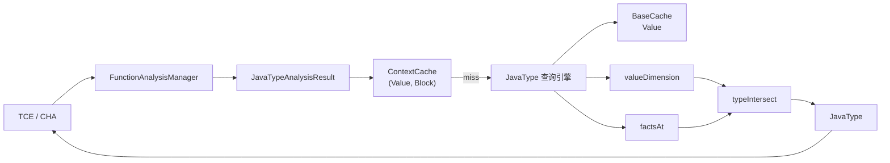
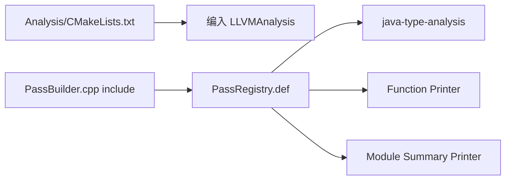
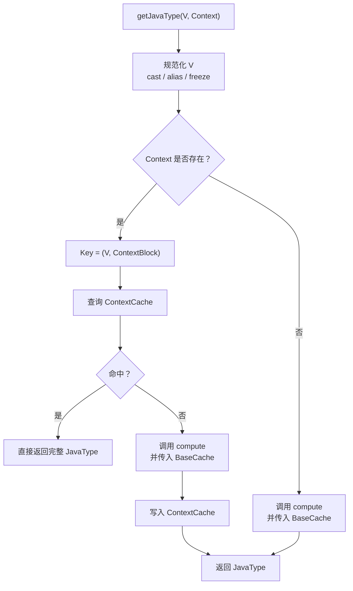

# AI 迭代第一版设计

设计的有点怪，改动有点多，因此得看一下这第一版是具体咋整的

## 总改动

**总的改动列表：**其中，主要的改动还是 `JavaType` 和`JavaTypeAnalysis`，`PassBuilder.cpp`和`PassRegistry.def`是注册，`CmakeLists.txt`是编译，剩下的是应用层改动。

两层缓存：

- `BaseCache[Value]`：缓存上下文无关类型。
- `ContextCache[(Value, BasicBlock)]`：缓存指定基本块处的完整类型。

上下文缓存 miss 时，会把 `BaseCache` 传入新版查询引擎，实现不同 Context 之间的基础结果复用。（**没看懂**）

PHI 递归状态、CFG 遍历状态和查询预算仍然每次重新创建，没有跨查询保存。

`JavaTypeAnalysis` 同时依赖 `DominatorTreeAnalysis` 和 `LazyValueAnalysis`。

缓存键统一处理 pointer cast、alias 和 `freeze`。（**没懂**）

`verify` 使用新版 `JavaType::operator==`，会比较：（**没懂**）

- `Klass`
- `Exact`
- `Interfaces`
- `ExcludedKlasses`

分别统计基础缓存和上下文缓存的 hit/miss。

保留：

- `-jeandle-disable-java-type-cache`
- `-jeandle-verify-java-type-cache`
- Function/Module 统计 Printer

| 文件                                                         | 状态 | 主要改动                                                     | 功能                                                         |
| ------------------------------------------------------------ | ---- | ------------------------------------------------------------ | ------------------------------------------------------------ |
| [JavaType.h (line 77)](/home/zjj/jeandle/jeandle-llvm/llvm/include/llvm/IR/Jeandle/JavaType.h:77) | 修改 | 增加 `JavaTypeBaseCache`；给 `getJavaType` 增加可选缓存参数；导出 Value 规范化函数 | 允许不同 Context 查询复用基础类型，并统一 cast/alias/freeze 的缓存键 |
| [JavaType.cpp (line 391)](/home/zjj/jeandle/jeandle-llvm/llvm/lib/IR/Jeandle/JavaType.cpp:391) | 修改 | 原有查询内 `BaseMemo` 接入可选共享缓存；保留查询局部的 PHI、CFG 和预算状态 | 打通 `JavaTypeAnalysis::BaseCache` 与现有类型计算引擎        |
| [JavaTypeAnalysis.h (line 33)](/home/zjj/jeandle/jeandle-llvm/llvm/include/llvm/Analysis/Jeandle/JavaTypeAnalysis.h:33) | 新增 | 定义 `JavaTypeAnalysis`、Result、两层缓存和 Printer Pass     | 建立 Function 级缓存所有权和对外查询接口                     |
| [JavaTypeAnalysis.cpp (line 119)](/home/zjj/jeandle/jeandle-llvm/llvm/lib/Analysis/Jeandle/JavaTypeAnalysis.cpp:119) | 新增 | 实现查询、DT/LVI 接入、失效、清空、验证和统计                | 管理 `BaseCache` 与 `ContextCache`，并调用现有 JavaType 引擎 |
| [Analysis/CMakeLists.txt (line 166)](/home/zjj/jeandle/jeandle-llvm/llvm/lib/Analysis/CMakeLists.txt:166) | 修改 | 添加 `Jeandle/JavaTypeAnalysis.cpp`                          | 将新 Analysis 编入 `LLVMAnalysis`                            |
| [PassBuilder.cpp (line 51)](/home/zjj/jeandle/jeandle-llvm/llvm/lib/Passes/PassBuilder.cpp:51) | 修改 | 包含 `JavaTypeAnalysis.h`                                    | 让静态 Pass 注册表能够构造新 Analysis 和 Printer             |
| [PassRegistry.def (line 147)](/home/zjj/jeandle/jeandle-llvm/llvm/lib/Passes/PassRegistry.def:147) | 修改 | 注册 Analysis、Function Printer、Module Summary Printer      | 支持 `java-type-analysis` 和统计输出 pipeline                |
| [TypeCheckElimination.cpp (line 69)](/home/zjj/jeandle/jeandle-llvm/llvm/lib/Transforms/Jeandle/TypeCheckElimination.cpp:69) | 修改 | 从直接调用 `jeandle::getJavaType` 改为获取 `JavaTypeAnalysis`；修改 IR 后清空缓存 | TCE 使用两层缓存复用类型查询结果                             |
| [CHADevirtualization.cpp (line 365)](/home/zjj/jeandle/jeandle-llvm/llvm/lib/Transforms/Jeandle/CHADevirtualization.cpp:365) | 修改 | 普通调用和 MethodHandle 查询迁移到 Analysis；每次成功改写后清空 JavaType 缓存与 LVI | CHA 在边查询边改 CFG 的情况下安全使用缓存                    |

缓存结构对应如下：

| 缓存           | Key                              | Value                     | 生命周期                                   |
| -------------- | -------------------------------- | ------------------------- | ------------------------------------------ |
| `BaseCache`    | 规范化后的 `Value*`              | 上下文无关 `JavaType`     | Function Analysis 生命周期，修改后保守清空 |
| `ContextCache` | `(Value*, ContextBB*)`           | 指定位置的完整 `JavaType` | Function Analysis 生命周期，修改后保守清空 |
| 查询局部状态   | `(Value*, Block*)`、PHI 递归栈等 | CFG 中间结果              | 单次 `getJavaType` 调用                    |

**用法如下：**

```
// 先定义
auto &JavaTypes = FAM.getResult<jeandle::JavaTYpeAnalysis>(F);

// 要使用的时候
jeandle::JavaType ObjType = JavaTypes.getJavaType(Obj, CheckCB);

// 清空缓存
JavaTypes.clear();
```

## 细节



图一：这里也就是说，当前的设计是把JavaType暴露在外面了，也把缓存暴露在外面了，后面要做的大概就是把这块包装成对 JavaType类的直接使用，而不是改造 JavaType 方法，把缓存包裹在类里面。但是目前顺序应该是没问题，TCE和CHA去使用 FAM 管理的 `JavaTypeAnalysisResult` 缓存，如果缓存miss，再去使用新版 JavaType 查询引擎，然后走依赖。(**这里写的好像不太对**)

### 阶段0，LLVM 认识 JavaTypeAnalysis

> 解决如何让 JavaTypeAnalysis 被编译并注册到 PassManager。



| 图中节点         | 代码位置                                                     | 作用                         |
| ---------------- | ------------------------------------------------------------ | ---------------------------- |
| CMake            | [Analysis/CMakeLists.txt (line 166)](/home/zjj/jeandle/jeandle-llvm/llvm/lib/Analysis/CMakeLists.txt:166) | 编译 `JavaTypeAnalysis.cpp`  |
| Header           | [PassBuilder.cpp (line 51)](/home/zjj/jeandle/jeandle-llvm/llvm/lib/Passes/PassBuilder.cpp:51) | 让注册代码看到类定义         |
| Analysis         | [PassRegistry.def (line 387)](/home/zjj/jeandle/jeandle-llvm/llvm/lib/Passes/PassRegistry.def:387) | 注册 `java-type-analysis`    |
| Function Printer | [PassRegistry.def (line 553)](/home/zjj/jeandle/jeandle-llvm/llvm/lib/Passes/PassRegistry.def:553) | 打印单个 Function 的缓存统计 |
| Module Printer   | [PassRegistry.def (line 147)](/home/zjj/jeandle/jeandle-llvm/llvm/lib/Passes/PassRegistry.def:147) | 打印进程累计统计             |

这里用了三个pass，一个pass是 java-type-analysis pass，剩下两个是打印pass。这一步完成后才能使用：`FAM.getResult<jeandle::JavaTypeAnalysis>(F)`

### 阶段1，FAM 创建并持有 Analysis Result

工厂方法：依赖 DT 和 LVI。

```
JavaTypeAnalysis::run(Function &F, FunctionAnalysisManager &FAM) {
  DominatorTree &DT = FAM.getResult<DominatorTreeAnalysis>(F);
  LazyValueInfo &LVI = FAM.getResult<LazyValueAnalysis>(F);
  return JavaTypeAnalysisResult(F, DT, LVI);
}
```

Result 内部结构：

```
class JavaTypeAnalysisResult {
public:
  LLVM_ABI JavaType getJavaType(Value *V,
                                Instruction *Context = nullptr);
  LLVM_ABI void clear();
  LLVM_ABI void print(raw_ostream &OS) const;

  LLVM_ABI bool invalidate(Function &F, const PreservedAnalyses &PA,
                           FunctionAnalysisManager::Invalidator &Inv);

private:
  friend class JavaTypeAnalysis;

  using ContextKey = std::pair<Value *, BasicBlock *>;

  JavaTypeAnalysisResult(Function &F, DominatorTree &DT, LazyValueInfo &LVI)
      : F(F), DT(DT), LVI(LVI) {}

  JavaType compute(Value *V, Instruction *Context,
                   JavaTypeBaseCache *SharedBaseCache);

  Function &F;
  DominatorTree &DT;
  LazyValueInfo &LVI;
  
  // 两层缓存
  JavaTypeBaseCache BaseCache;
  DenseMap<ContextKey, JavaType> ContextCache;

  // 统计
  struct Statistics {
    uint64_t Queries = 0;
    uint64_t ContextHits = 0;
    uint64_t ContextMisses = 0;
    uint64_t Bypasses = 0;
    uint64_t Clears = 0;
    uint64_t Verifications = 0;
    uint64_t TotalQueryTimeNanoseconds = 0;
    size_t PeakContextEntries = 0;
  } Stats;
};
```

### 阶段2，消费者发起类型查询

就是使用方式。

### 阶段3，实际入口

实际入口在：

```
JavaTypeAnalysisResult::getJavaType(Value *V,
                                    Instruction *Context)
```

**代码逻辑如下**：

1. 规范化：把V转换成这个分析约定的规范形式




规范化：为了消除 `bitcast` `addrspacecast ` `alias` `freeze`，统一成同一个 `%v`.`bitcast`、`addrspacecast`、`freeze` 是 LLVM IR 指令，类型查询时沿这些操作追溯到一个共同的来源值，用它作为查询对象和缓存键；通常不修改原来的 IR。

```
%v
bitcast(%v)
freeze(bitcast(%v))

; 假设该地址空间转换有效，而且 %v 是已定义的对象引用
%a = addrspacecast ptr addrspace(1) %v to ptr
%b = freeze ptr %a

%v、%a、%b 是三个不同的 LLVM Value，但在这些前提下，它们引用同一个 Java 对象，所以可以剥离
```

#### 两个cache

`BaseCache` 和 `ContextCache`。

这里 `BaseCache` 似乎重新在 JavaType 里面加了一个，但是context cache用的是Analysis里的，不太理解为什么。然后因为他把 BaseCache放外面了，所以把JavaType好像又要用到这玩意？

```
/// Cache for context-insensitive Java type computations.
///
/// The cache may be shared by multiple top-level queries while the underlying
/// IR and VM type facts remain unchanged. It deliberately stores only
/// completed base-type computations; query-local CFG traversal, PHI recursion
/// state and budgets remain owned by each individual getJavaType invocation.
class JavaTypeBaseCache {
  DenseMap<Value *, JavaType> Entries;
  uint64_t Hits = 0;
  uint64_t Misses = 0;
  uint64_t Insertions = 0;
  size_t PeakEntries = 0;

public:
  const JavaType *lookup(Value *V) {
    auto It = Entries.find(V);
    if (It == Entries.end()) {
      ++Misses;
      return nullptr;
    }
    ++Hits;
    return &It->second;
  }

  void insert(Value *V, const JavaType &Type) {
    if (Entries.try_emplace(V, Type).second) {
      ++Insertions;
      PeakEntries = std::max(PeakEntries, Entries.size());
    }
  }

  /// Discard entries while retaining lifetime statistics.
  void clear() { Entries.clear(); }

  size_t size() const { return Entries.size(); }
  size_t peakEntries() const { return PeakEntries; }
  uint64_t hits() const { return Hits; }
  uint64_t misses() const { return Misses; }
  uint64_t insertions() const { return Insertions; }
};
```


### 阶段4，compute函数


## 关键问题

1. 什么叫**上下文缓存 miss 时，会把 `BaseCache` 传入新版查询引擎，实现不同 Context 之间的基础结果复用。**

2. AM的使用啥玩意的，基本原理
3. 把V规范化的用途：`canonicalizeJavaTypeQueryValue()`
4. Basecache 是多出来干什么的
5. 性能计算

6. 有一些多余的

### LLVM New Pass Manager 分析管理机制

**准确地说：`FAM.getResult<JavaTypeAnalysis>(F)` 在没有有效缓存时，会调用该 analysis 的 `run(F, FAM)` 来生成结果。** 相当于向一个带缓存的管理器请求结果，缺少结果时候，管理器会调用对应的生产函数。

以下面这个为例：

```
class JavaTypeAnalysis : public AnalysisInfoMixin<JavaTypeAnalysis> {
  friend AnalysisInfoMixin<JavaTypeAnalysis>;
  LLVM_ABI static AnalysisKey Key;

public:
  using Result = JavaTypeAnalysisResult;
  LLVM_ABI Result run(Function &F, FunctionAnalysisManager &FAM);
};
```

`JavaTypeAnalysis`相当于一个分析描述，result是他的结果，类型是 `JavaTypeAnalysisResult`类型。

通过注册进 FAM，让 FAM 持有对应的分析对象及其调用包装。而 `run()`是框架的接口约定。然后当管理者 FAM 调用 `getResult<>(F)`时候，FAM 先判断自己是否已经持有这个函数的 Result；有的话，连 `JavaTypeAnalysis::run()` 都不调用，没有才调用。

**本质工厂方法。**

**`Analysis::run()` 可以理解为生产 Result 的工厂方法**；FAM 则在外面加上了**缓存与生命周期管理**：

- 没有缓存 → 调用 `run()` 创建 Result。
- 有有效缓存 → 返回已有 Result。
- Result 失效 → 清除，下次请求时重新创建。

拿到 Result 后，使用者调用它自己的业务接口即可。

严格按设计模式术语，不必认定它完全对应 GoF 的 Factory Method 模式，但你用“工厂方法”理解这里的职责是准确的。

### 疑似ai改多了的地方

1. 规范化这地方，这里多套了一层还改我名字

```
Value *jeandle::canonicalizeJavaTypeQueryValue(Value *V) {
  while (true) {
    V = V->stripPointerCastsAndAliases();
    if (auto *FI = dyn_cast<FreezeInst>(V)) {
      V = FI->getOperand(0);
      continue;
    }
    return V;
  }
}

static Value *stripCastsAndFreeze(Value *V) {
  return canonicalizeJavaTypeQueryValue(V);
}
```

### BaseCache

物理意义就是把查过的多设了一层缓存，但是归属还是在Analysis里面，所以我的问题是这bi玩意为啥改了原来的 getJavaType

```
class JavaTypeBaseCache {
  DenseMap<Value *, JavaType> Entries;
```

注意这一块：

```
调用方：AnalysisResult.getJavaType(V, Context)                [1]
  │
  ├─ 有 Context：先查 ContextCache[(V, Context所在的BB)]
  │    ├─ 命中 → 直接返回，不进入计算引擎，也不创建 Q
  │    └─ 未命中 ──┐
  │               │
  └─ 无 Context ──┤
                  ▼
         compute(V, Context, &BaseCache)                    [2]
                  │
                  ▼
         jeandle::getJavaType(..., BaseCache)               [3]
                  │
          ┌───────┴─────────────────┐
          │ 无 Context              │ 有 Context
          ▼                         ▼
   getBaseJavaType(...,       创建本次查询的 Q
                   BaseCache) Q.SharedBaseTypes = BaseCache
          │                         │
          │                   valueDimension(V, Q)
          │                         │ 基础类型计算路径
          │                         ▼
          │                   getBaseJavaType(...,
          │                                   &Q.baseTypes())
          └────────────┬────────────┘
                       ▼
             读写同一个外部 BaseCache                      [4]

有 Context 时，还会结合 factsAt(...) 的路径事实，
最终结果由 AnalysisResult 写入 ContextCache。
```

