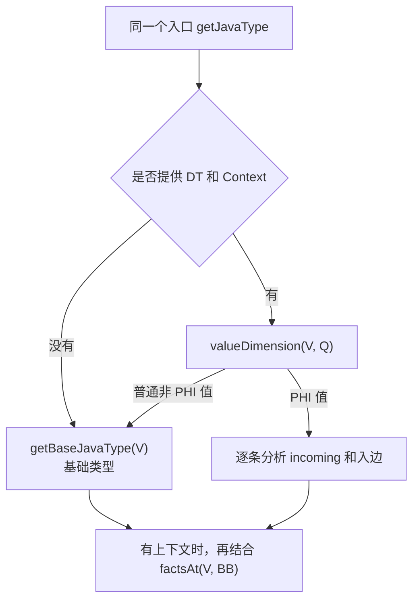
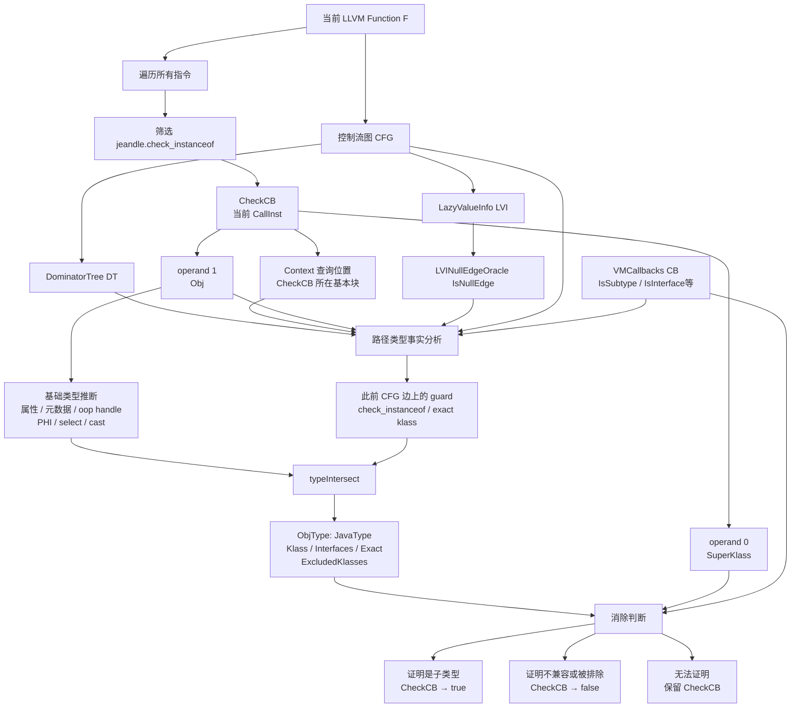
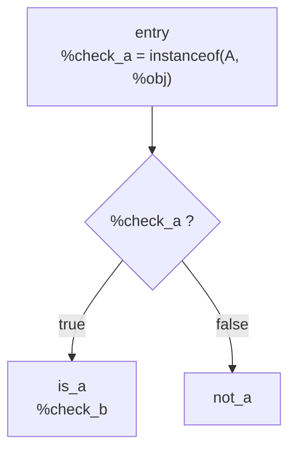
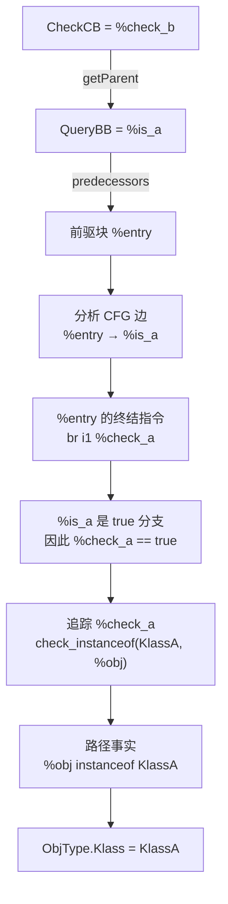
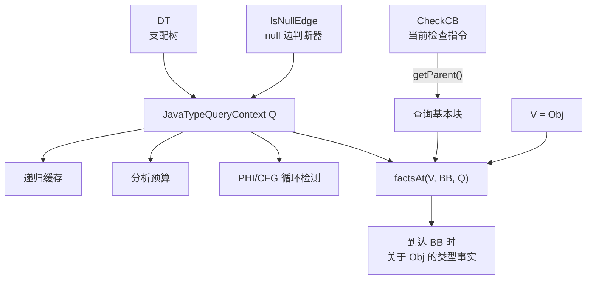

# 以TCE为例研究新版改动

## 问题

> 这个 `IsNullEdgeOracle` 是啥玩意？

# getJavaType




## 试图梳理

```
Value *Obj = CheckCB->getArgOperand(1); // 第二个实参

jeandle::JavaType ObjType =
        jeandle::getJavaType(Obj, &DT, CheckCB, IsNullEdge);
```

| 实参         | 形参类型               | 含义                                    | 主要依赖                                                     |
| ------------ | ---------------------- | --------------------------------------- | ------------------------------------------------------------ |
| `Obj`        | `Value *V`             | 要推断 Java 类型的 LLVM SSA 值          | 参数属性、load 元数据、常量 oop、PHI/select/cast、此前的类型检查 |
| `&DT`        | `DominatorTree *DT`    | 当前函数的支配树                        | 当前函数的 CFG                                               |
| `CheckCB`    | `Instruction *Context` | 类型查询发生的位置                      | 当前 `check_instanceof` 指令所在的基本块                     |
| `IsNullEdge` | `IsNullEdgeOracle`     | 判断某条 CFG 边上 `Obj` 是否必定为 null | `LazyValueInfo`、CFG 和分支条件                              |

1. 为什么是取第二个实参？根据 `check_instanceof` 的函数声明，第一个是要检查的类型，第二个是被检查的对象。

```
declare i1 @jeandle.check_instanceof(
    ptr %super_klass,
    ptr addrspace(1) nonnull %oop)
```

2. `CheckCB`，当前正在处理的 `jeandle.check_instanceof` 调用指令类型 `CallInst`，来自这个循环，实际就是指令。然后这个指令传进去的作用，是为了拿到当前指令所在的基本块的。

```
if (CheckFn && Check->getCalledFunction() == CheckFn)
  Checks.push_back(Check);
  
for (CallInst *CheckCB : Checks) {
    ...
}
```

3. `isNullEdge`是什么东西？

```
LazyValueInfo &LVI = FAM.getResult<LazyValueAnalysis>(F);
LVINullEdgeOracle IsNullEdge{LVI};

// 查询的函数
LVI.getPredicateOnEdge();
```

这玩意调用了一个AM，拿到分析结果，是一个 `LazyValue` 的分析，然后这个给 `IsNullEdge`，作为 `LVINullEdgeOracle `类型的初始化。

其中，这个数据结构类型是：在 `FromBB -> ToBB` 这条边上，`V` 是否可以被严格证明为 null。只有明确证明为 null 才返回 `true`；无法判断时返回 `false`，保留这条路径。这是保守策略。

```
bool(Value *V, BasicBlock *FromBB, BasicBlock *ToBB)
```



# 总体思路

```
ObjType =
    Obj 自身携带的基础类型
    ∩
    从函数入口到 CheckCB 所在基本块的所有有效路径共同证明的类型事实

ObjType其中的四类信息：
    ObjType.Klass             // 已知的 Java Klass，0 表示未知
    ObjType.Interfaces        // 已知实现的接口
    ObjType.Exact             // 是否确定就是该类，而非其子类
    ObjType.ExcludedKlasses   // 已知绝对不是哪些类及其子类

四个参数作用：
    CheckCB 决定查询终点
    DT 决定控制流/回边/支配关系
    IsNullEdge 排除 Obj 必定为 null 的路径
    Obj 决定具体分析哪个 SSA 值
    
```

## 倒追流程的模拟

下面是一段 LLVM IR：

```
entry:
  %check_a = call i1 @jeandle.check_instanceof(
      ptr %KlassA,
      ptr addrspace(1) %obj)

  br i1 %check_a, label %is_a, label %not_a

is_a:
  %check_b = call i1 @jeandle.check_instanceof(
      ptr %KlassB,
      ptr addrspace(1) %obj)

  ret i1 %check_b

not_a:
  ret i1 false
```

对应控制流：



1. `checkcb = %check_b; Obj = %obj; getJavaType(Obj, &DT, CheckCB, IsNullEdge); `这个是 处理 `%check_b` 时候发生的。
2. 定位查询位置：具体的基本块，`Context->getParent()`，得到 %is_a，然后根据基本块，通过`factsAt()`，这个相当于拿到到达这个基本块时候必须满足的信息，方便找前驱啥的。

3. 倒追前驱，分析前驱边上的分支条件，查看终结指令（就是那个根据条件跳转的指令，因为跳转结果已经知道，所以可以根据结果推导条件）

```
for (BasicBlock *P : predecessors(BB)) {
    ...
}
```

4. 拿到了推导出的条件答案，继续追踪该条件是怎么的出来的，然后拿到那个事实。



伪代码总结 `getJavaType()` 功能如下：

```
JavaType getJavaType(Obj, DT, CheckCB, IsNullEdge) {
    // Obj 自身携带的类型：属性、metadata、PHI 等
    JavaType BaseType = getBaseType(Obj);

    // CheckCB 只在这里用于确定查询位置
    BasicBlock *QueryBB = CheckCB->getParent();

    // 从 QueryBB 沿前驱边向前追踪
    JavaType PathFacts = factsAt(Obj, QueryBB);

    // 合并“值自身类型”和“到达当前位置必然成立的事实”
    return typeIntersect(BaseType, PathFacts);
}
```

## 还有一个相关数据结构 JavaTypeQueryContext

**一次 Java类型查询使用的分析上下文和临时状态：**比如 factsAt 函数里，需要这个数据结构作为参数，利用 `Q` 中的支配树、null 边判断器和缓存，计算 `%obj` 在进入 `%is_a` 时成立的路径类型事实。

```
struct JavaTypeQueryContext {
  DominatorTree &DT;
  IsNullEdgeOracle NullOracle;

  SmallPtrSet<const PHINode *, 8> PhiVisited;
  BaseMemo BaseTypes;

  DenseMap<
      std::pair<Value *, BasicBlock *>,
      std::optional<JavaType>>
      Processed;

  unsigned FactsBudget = MaxFactsJoinBlocks;
  unsigned PhiBudget = MaxFactsJoinBlocks;
};
```

| 字段          | 作用                                               |
| ------------- | -------------------------------------------------- |
| `DT`          | 支配树，用于分析 CFG、**可达性分析**和**回边检测** |
| `NullOracle`  | 判断某条 CFG 边上对象是否必定为 null               |
| `PhiVisited`  | 防止分析 PHI 时无限递归                            |
| `BaseTypes`   | 缓存已经计算过的基础类型                           |
| `Processed`   | 缓存 `(值, 基本块)` 对应的路径事实                 |
| `FactsBudget` | 限制 CFG 递归分析规模                              |
| `PhiBudget`   | 限制 PHI 递归分析规模                              |


