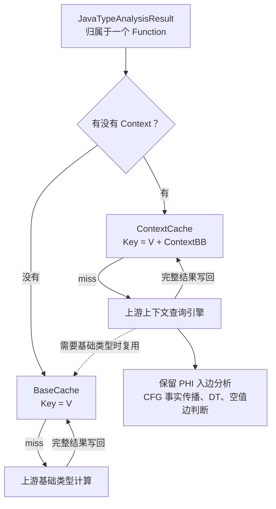

| 缓存           | Key                     | 存什么                       |
| -------------- | ----------------------- | ---------------------------- |
| `BaseCache`    | `Value*`                | 不考虑查询位置时的基础类型   |
| `ContextCache` | `(Value*, BasicBlock*)` | 该值在这个块处的完整类型结果 |

建议把 Cache 拆成。

查询同一个值在不同块的类型时，完整结果可能不同，但其中需要的基础类型可以复用。

如果 `ContextCache` miss 后仍直接调用完全不认识 `BaseCache` 的上游函数，那么它依然会重新计算基础部分。